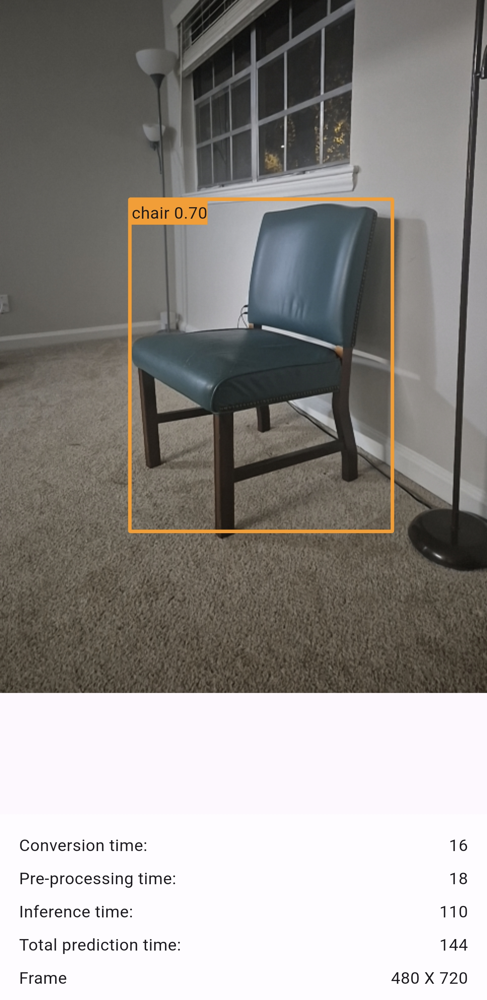
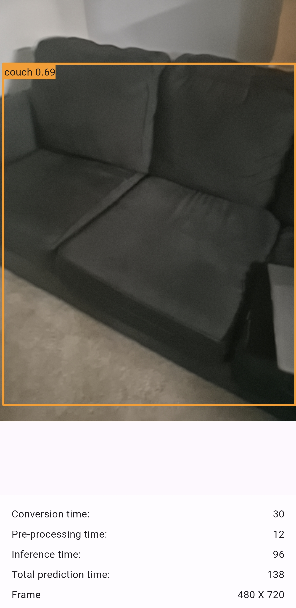
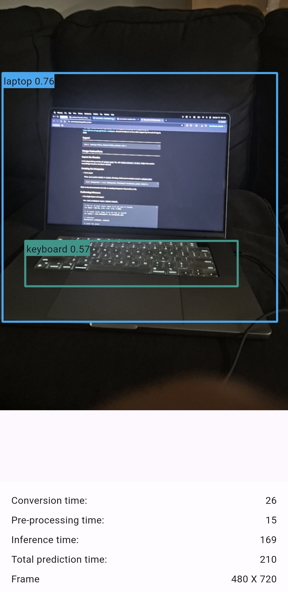
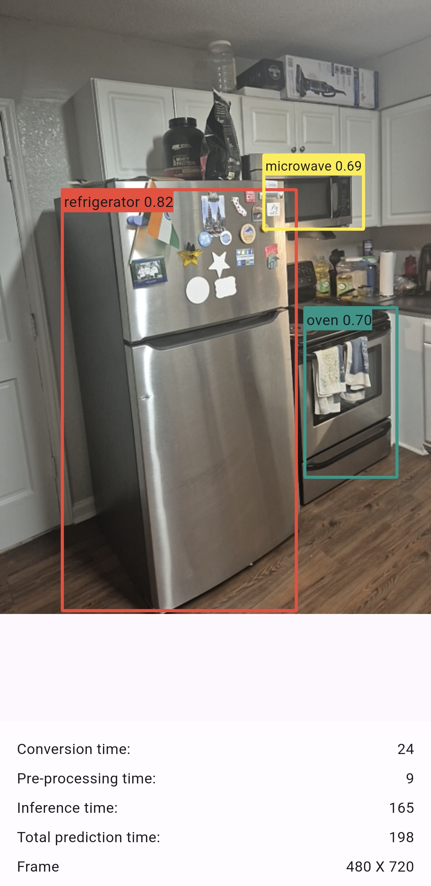
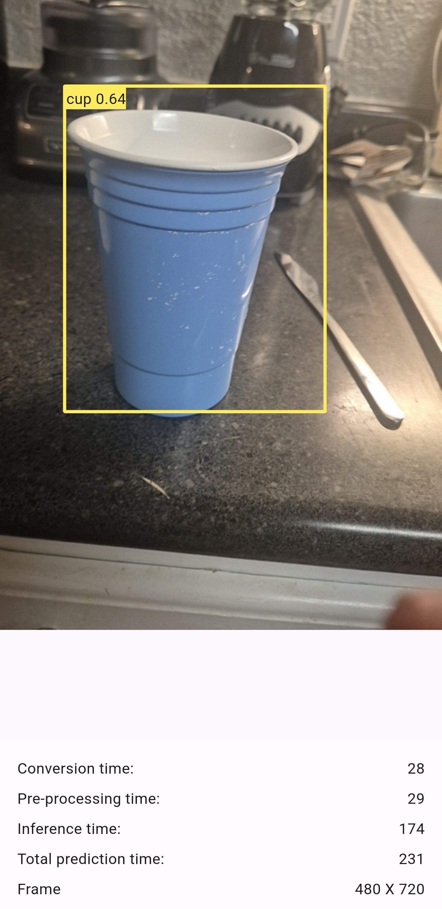
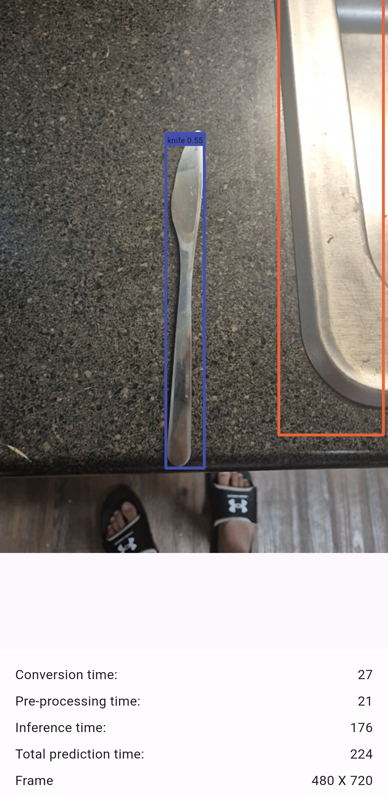

<div align="center">

# 🤖 AI on the Edge

### On-Device Machine Learning with Flutter & TensorFlow Lite

*What if your app could recognize images, process voice commands, or detect gestures, all without sending data to the
cloud?*

[](presentation.pdf)
[](https://gdg.community.dev/events/details/google-gdg-chapel-hill-presents-north-carolina-devfest-2025/)


</div>

---

## 📖 About the talk

In this talk, we show you how to run real machine learning models directly on users' devices using TensorFlow Lite and
Flutter. Learn to convert models, integrate them with the `tflite_flutter` plugin, and build apps that are fast,
private, and work completely offline.

Whether you're new to ML or already experimenting, this session will equip you to add real-time, powerful AI to your
Flutter apps, no cloud required.

## 🎯 What you'll learn

- 🔄 Converting TensorFlow models to `.tflite`
- 🔌 Integrating models with the `tflite_flutter` plugin
- 📷 Running real-time inference on a live camera feed
- ⚡ Performance and optimization tips for deploying AI at the edge

## 💻 Demo app: live object detection

The [`object-classifier`](./object-classifier) app uses Google's quantized **COCO (Common Objects in Context)** model to
detect 80 everyday objects in real time, entirely on-device.

```bash
cd object-classifier
flutter pub get
flutter run   # use a physical device for camera access
```

> [!NOTE]
> Want to bring your own model? See the [TensorFlow → TFLite conversion guide](./object-classifier/README.md).

### 📸 Screenshots

<p align="center">
  
  
  
</p>
<p align="center">
  
  
  
</p>

## 🔗 Resources

| Resource             | Link                                                                       |
|----------------------|----------------------------------------------------------------------------|
| 📦 tflite_flutter    | [pub.dev/packages/tflite_flutter](https://pub.dev/packages/tflite_flutter) |
| 🔄 Convert to TFLite | [Conversion guide](./object-classifier/README.md)                          |

---

<div align="center">

## 📫 Connect with me

[](https://yashashm.dev)
&nbsp;
[](mailto:yashashm.dev@gmail.com)
&nbsp;
[](https://www.linkedin.com/in/yashashm)
&nbsp;
[](https://twitter.com/YashasMajmudar)

<sub>[← Back to all talks](../README.md)</sub>

</div>
